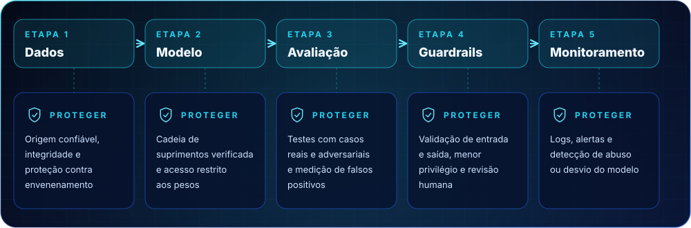
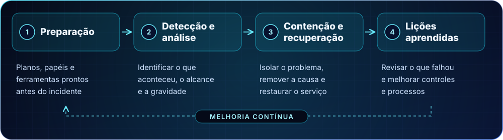
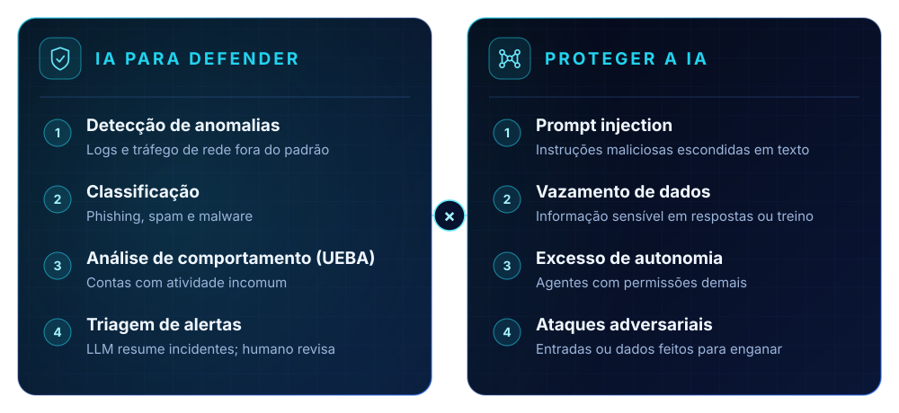
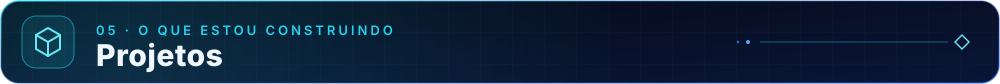
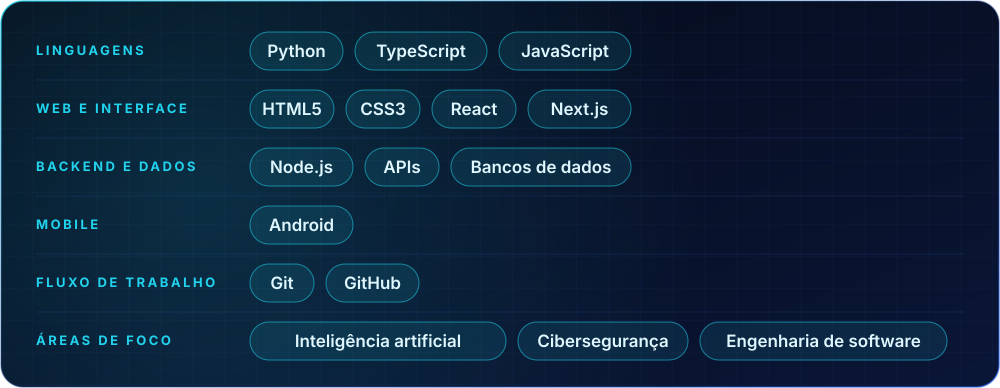
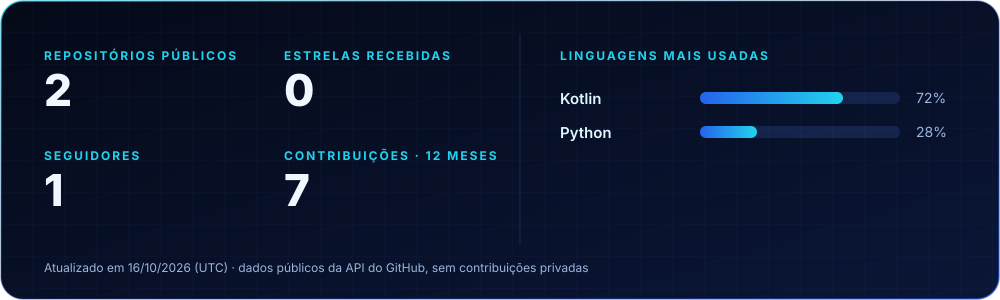

  <picture>
    <source media="(max-width: 640px) and (prefers-reduced-motion: reduce)" srcset="assets/flayks-hero-mobile-static.svg">
    <source media="(max-width: 640px)" srcset="assets/flayks-hero-mobile.svg">
    <source media="(prefers-reduced-motion: reduce)" srcset="assets/flayks-hero-static.svg">
    
  </picture>

 

### Engenharia de software com foco em **Inteligência Artificial** e **Cibersegurança**

IA que ajuda a defender sistemas · Sistemas de IA que precisam ser defendidos

 

<a href="#foco">Foco</a> · <a href="#ia">IA</a> · <a href="#ciber">Cibersegurança</a> · <a href="#cruzamento">IA × Segurança</a> · <a href="#projetos">Projetos</a> · <a href="#stack">Stack</a> · <a href="#contato">Contato</a>

 

Sou fundador da [Netsenti AI](https://netsenti.com) e trabalho na interseção de duas áreas que se influenciam o tempo todo:

| | |
| :-- | :-- |
| 🤖 **IA aplicada** | Usar modelos de aprendizado de máquina e IA generativa como parte do produto, com avaliação e limites claros. |
| 🛡️ **Cibersegurança** | Projetar sistemas seguros desde o início e entender como eles são atacados para defendê-los melhor. |
| ⚙️ **Engenharia de software** | Transformar essas ideias em código mantível: interfaces, APIs e dados. |

> 🇯🇵 Representante brasileiro no **SusHi Tech Tokyo 2026** · 🥉 **Bronze Winner, Best AI Innovation** — International AI Awards 2026

 

Um mapa resumido do que a área contém e de como eu a organizo.

<b>Tipos de IA por capacidade</b>

 

| Tipo | O que é | Situação |
| :-- | :-- | :-- |
| **IA estreita (ANI)** | Resolve tarefas específicas: recomendação, classificação, tradução, geração de texto. | É toda a IA em uso hoje. |
| **IA geral (AGI)** | Capacidade de aprender e raciocinar em qualquer domínio, como uma pessoa. | Conceito ainda teórico. |
| **Superinteligência (ASI)** | Inteligência acima da humana em praticamente tudo. | Hipotética. |

<b>Paradigmas de aprendizado</b>

 

| Paradigma | Como aprende | Exemplos de uso |
| :-- | :-- | :-- |
| **Supervisionado** | A partir de dados com resposta conhecida (rótulos). | Classificar e-mails como phishing, prever preços. |
| **Não supervisionado** | Encontra estrutura em dados sem rótulo. | Agrupamento de usuários, detecção de anomalias. |
| **Auto-supervisionado** | Gera os próprios rótulos a partir dos dados. | Pré-treino de modelos de linguagem. |
| **Por reforço** | Aprende por tentativa e erro, guiado por recompensas. | Jogos, robótica, otimização de decisões. |

<b>Famílias de modelos</b>

 

| Família | Exemplos | Quando faz sentido |
| :-- | :-- | :-- |
| **Machine learning clássico** | Regressão, árvores de decisão, Random Forest, gradient boosting, SVM | Dados tabulares, poucos dados, necessidade de explicabilidade. |
| **Deep learning** | Redes convolucionais (CNN), recorrentes (RNN/LSTM), Transformers | Imagem, áudio, texto e dados complexos em grande volume. |
| **IA generativa** | LLMs, modelos de difusão, GANs, VAEs | Gerar texto, código, imagem; conversar; resumir. |
| **Sistemas com agentes** | LLM + ferramentas + memória + planejamento | Tarefas de várias etapas que exigem consultar e agir em outros sistemas. |

<b>Técnicas em aplicações com LLM</b>

 

- **Engenharia de prompt:** instruções claras, exemplos e formato de saída definido.
- **RAG (Retrieval-Augmented Generation):** o modelo consulta uma base de conhecimento (via embeddings e busca vetorial) antes de responder, o que reduz respostas inventadas e mantém o conteúdo atualizado.
- **Fine-tuning:** ajustar um modelo a um domínio ou estilo específico quando o prompt não basta.
- **Uso de ferramentas (tool use):** o modelo chama APIs e funções com argumentos estruturados.
- **Avaliação:** testes com casos reais e métricas (precisão, recall, taxa de falsos positivos) antes de confiar no resultado.
- **Guardrails:** validação de entrada e saída, limites de permissão e revisão humana em ações sensíveis.

Em um sistema de IA, cada etapa do fluxo tem um risco próprio. O diagrama mostra o que proteger em cada uma:

 

<b>Princípios que guiam as decisões</b>

 

| Princípio | Ideia central |
| :-- | :-- |
| **Tríade CIA** | Proteger a **confidencialidade**, a **integridade** e a **disponibilidade** da informação. |
| **Menor privilégio** | Cada pessoa e cada serviço recebe só o acesso de que precisa. |
| **Defesa em profundidade** | Várias camadas de controle, para que uma falha isolada não derrube tudo. |
| **Zero Trust** | Nenhuma conexão é confiável por padrão: verificar sempre, dentro e fora da rede. |
| **Secure by design** | Segurança entra na arquitetura, não como remendo no final. |

<b>Técnicas defensivas</b>

 

| Camada | Técnicas |
| :-- | :-- |
| **Identidade e acesso** | Autenticação multifator (MFA), controle de acesso por papéis (RBAC), gestão de sessões e tokens |
| **Criptografia** | TLS em trânsito, criptografia em repouso, hash de senhas com algoritmos próprios para isso (bcrypt, Argon2), gestão de segredos |
| **Código seguro** | Validação e sanitização de entrada, consultas parametrizadas, tratamento de erros, revisão de código |
| **Cadeia de suprimentos** | Análise de dependências, atualização de pacotes vulneráveis, lockfiles |
| **Detecção** | Logs centralizados, monitoramento, alertas, SIEM, análise de comportamento |
| **Resiliência** | Backups testados, segmentação de rede, plano de recuperação |

<b>Frameworks de referência</b>

 

- **OWASP Top 10:** os riscos mais comuns em aplicações web (controle de acesso quebrado, injeção, falhas criptográficas, entre outros).
- **MITRE ATT&CK:** catálogo de táticas e técnicas de atacantes, útil para mapear detecções.
- **NIST Cybersecurity Framework:** organiza a gestão de risco em funções, da governança à recuperação.
- **ISO/IEC 27001:** padrão para sistemas de gestão de segurança da informação.

Resposta a incidentes é um ciclo, não uma lista de tarefas isoladas: o que se aprende no fim melhora a preparação do começo.

 

A IA entra na segurança de duas maneiras: como ferramenta de defesa e como sistema que precisa ser protegido.

 

Referência para o segundo lado: o projeto **OWASP Top 10 for LLM Applications**. As defesas combinam validação de entrada e saída, menor privilégio para agentes, separação entre dados e instruções, monitoramento e revisão humana.

 

<a href="https://netsenti.com">
  <picture>
    <source media="(max-width: 640px)" srcset="assets/project-netsenti-ai-mobile.svg">
    
  </picture>
</a>

**[Netsenti AI](https://netsenti.com)** é um projeto próprio, criado por mim do conceito ao protótipo, que une inteligência artificial e cibersegurança.
**Status:** protótipo em desenvolvimento. · **Código:** [github.com/flayksdev/netsent_ai](https://github.com/flayksdev/netsent_ai)

 

<picture>
  <source media="(max-width: 640px)" srcset="assets/project-larmatch-mobile.svg">
  
</picture>

**LarMatch** é um produto de descoberta de imóveis personalizada, que conecta cada pessoa aos imóveis que fazem sentido para o que ela procura.

 

 

- **Engenharia de Software** — graduação em andamento.
- **Alura (2026)** — React 19, React com TypeScript, React full stack, JavaScript, Python, HTML e CSS, Padrões de API e Lógica de programação, além de trilhas introdutórias de Node.js, **Cloud Security**, Engenharia de Dados, Governança de Dados e UI Design.
- **Idiomas** — português nativo, inglês intermediário.

 

Busco vaga de **desenvolvedor de software** (web, Android e IA), de preferência em **regime remoto**. Trabalho bem em equipe e gosto de aprender com quem sabe mais.

 

Gerado automaticamente todos os dias por um workflow deste repositório, a partir de dados públicos; não inclui contribuições privadas.

 

 

FLAYKS OLIVEIRA · Software Engineer · Founder · AI · Cybersecurity

