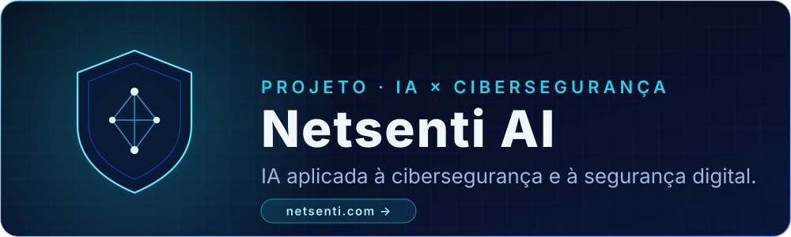
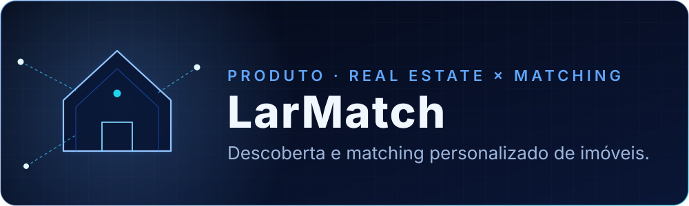

  <picture>
    <source media="(max-width: 640px) and (prefers-reduced-motion: reduce)" srcset="assets/flayks-hero-mobile-static.svg">
    <source media="(max-width: 640px)" srcset="assets/flayks-hero-mobile.svg">
    <source media="(prefers-reduced-motion: reduce)" srcset="assets/flayks-hero-static.svg">
    
  </picture>

 

**Engenharia de software no ponto em que IA e cibersegurança se encontram.**

## 👋 Sobre mim

Sou **FLAYKS OLIVEIRA**, engenheiro de software e fundador da [Netsenti AI](https://netsenti.com). Gosto de pegar uma ideia e levá-la até um produto funcionando: do conceito ao protótipo, passando por interface, API e banco de dados.

Desenvolvo **sites e aplicativos Android**, uso **inteligência artificial** para resolver problemas reais de produto e levo a **cibersegurança** em conta desde o desenho, não só no final. Trabalho bem em equipe e estou em busca de uma vaga como desenvolvedor.

- 🇯🇵 Representante brasileiro no **SusHi Tech Tokyo 2026**
- 🥉 **Bronze Winner, Best AI Innovation**, no International AI Awards 2026
- 🗣️ Português nativo · inglês intermediário

## 🧭 O que eu faço

| Área | O que isso significa na prática |
| :-- | :-- |
| **Web e interface** | Páginas e aplicações com `HTML5`, `CSS3`, `JavaScript`, `TypeScript`, `React` e `Next.js` |
| **Mobile** | Aplicativos para `Android` |
| **Backend e dados** | APIs e integração com bancos de dados usando `Node.js` e `Python` |
| **IA aplicada** | Usar inteligência artificial como parte do produto, não como enfeite |
| **Cibersegurança** | Pensar em segurança digital junto com a arquitetura |
| **Fluxo de trabalho** | Versionamento e colaboração com `Git` e `GitHub` |

## 🚀 Projetos

<a href="https://netsenti.com">
  <picture>
    <source media="(max-width: 640px)" srcset="assets/project-netsenti-ai-mobile.svg">
    
  </picture>
</a>

**[Netsenti AI](https://netsenti.com)** é um projeto próprio, que criei do conceito ao protótipo. A ideia é combinar inteligência artificial e cibersegurança para apoiar a segurança digital.
**Status:** protótipo em desenvolvimento. · **Código:** [github.com/flayksdev/netsent_ai](https://github.com/flayksdev/netsent_ai)

 

<picture>
  <source media="(max-width: 640px)" srcset="assets/project-larmatch-mobile.svg">
  
</picture>

**LarMatch** é um produto de descoberta de imóveis personalizada. Em vez de a pessoa filtrar listas infinitas, o foco é conectar cada pessoa aos imóveis que fazem sentido para o que ela procura.

## 🛠️ Linguagens e Tecnologias

## 🎓 Formação e cursos

- **Engenharia de Software** — graduação em andamento.
- **Alura (2026)** — React 19, React com TypeScript, React full stack, JavaScript, Python, HTML e CSS, Padrões de API e Lógica de programação, além de trilhas introdutórias de Node.js, Cloud Security, Engenharia de Dados, Governança de Dados e UI Design.

## 💼 Disponível para oportunidades

Busco vaga de **desenvolvedor de software** (web, Android e IA), de preferência em **regime remoto**. Posso contribuir com interface, API e protótipos de produto, e gosto de aprender com o time.

## 📊 Atividade no GitHub

Gráficos gerados por serviços de terceiros a partir de dados públicos do perfil; não são dados oficiais do GitHub. Se alguma imagem não carregar, o perfil completo está em [github.com/flayksdev](https://github.com/flayksdev).

## 🧠 Como eu trabalho

- **Clareza antes de esperteza.** Código simples vira produto que evolui.
- **Segurança desde o início.** É mais barato desenhar certo do que remendar depois.
- **Decisões por evidência.** Medir, testar e só então afirmar.
- **Produto é o objetivo.** Tecnologia importa quando resolve um problema de verdade.

## 📬 Contato

FLAYKS OLIVEIRA · Software Engineer · Founder · AI · Cybersecurity

